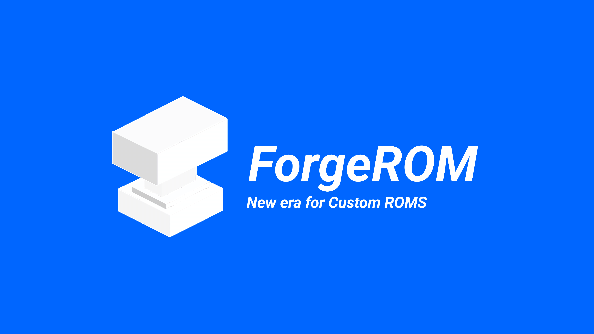
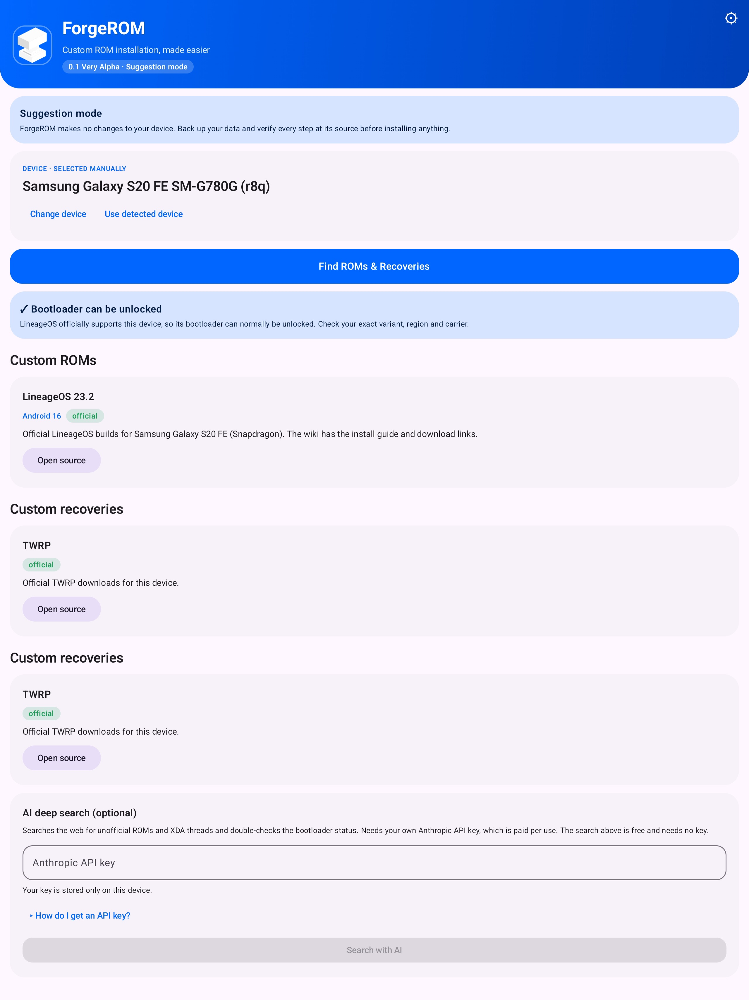
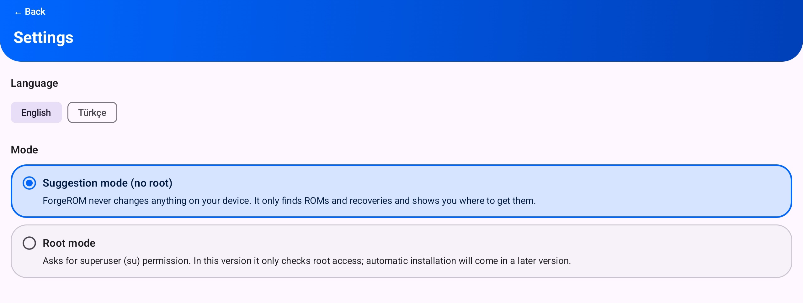

  

# ForgeROM 🚀 *(Work in Progress)*

## 🌟 Overview

**ForgeROM** is an advanced, open-source Custom ROM and Recovery hub designed for Android devices. It simplifies the process of finding, downloading, and installing custom software, bringing all official APIs together in one powerful application.

---

## ✨ Features

*   🔍 **Automatic Model Detection:** Detects your device automatically with an option for manual selection.
*   ⚡ **Root Mode (Auto Install):** Fully automated installation process for rooted devices.
*   🤖 **Built-in AI Assistant & Suggester:** Finds the best ROM recommendations for your needs (API key required; a free alternative is also available!).
*   🛡️ **100% Secure & Open-Source:** Downloads directly from official APIs (LineageOS, crDroid, TWRP, OrangeFox). No third-party servers.
*   🧠 **Smart Development:** Most of the core development is powered and optimized by **Claude Sonnet 5.5**.
*   🌐 **Localization:** Supports translatable strings for global community use.
*   🎨 **Modern UI:** Full Light and Dark mode support.
*   📱 **Wide Compatibility:** Built on SDK 26 (Supports Android 8.0+).

---

## 📸 Screenshots

  
  

---

## 🚀 Installation & Safety

This project is built automatically with **GitHub Actions CI/CD** to ensure clean and untouched builds.

1.  Go to the **Releases** section and download the latest APK.
2.  Install the APK on your device.
3.  ⚠️ **Play Protect Note:** If a security warning appears, tap *"Install anyway"*. 
4.  🛡️ **Why the warning?** This project is **100% open-source and safe**. The warning is standard for custom tools simply because the app is not signed with expensive Google Play Developer certificates. You can audit the entire source code right here.

---

## 🤝 Support and Author

*   👨‍💻 **Created by:** Galaxy Expert (Muratcan Yücepur)
*   🐛 **Feedback:** Report bugs or feature requests on GitHub Issues or XDA.
*   🙌 **Contributions:** Pull requests and community contributions are highly welcome!
*   📺 **Support the Developer:** Subscribe to [my YouTube channel](https://youtube.com/@galaxy_expert?si=LgdLLOAN8-JTZGSC) for more Android content.

---

## ⭐ Support the Project

If ForgeROM saved your time and made your flashing process easier, please **give this repository a Star (⭐)**! It helps the project grow, gain visibility on XDA/GitHub, and motivates me to add more features and APIs. 🌟

---

## 📄 License

This project is licensed under the **GNU General Public License**.
